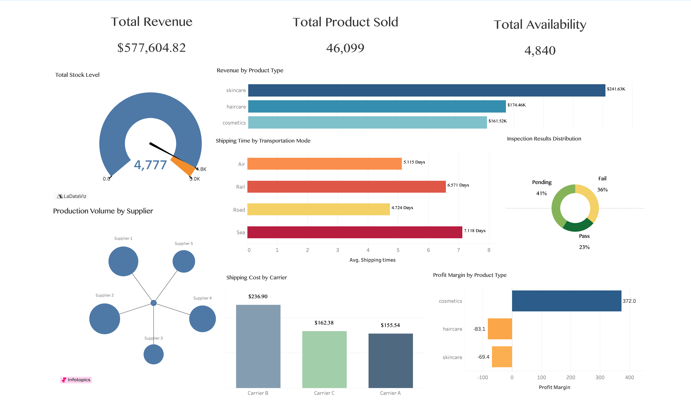
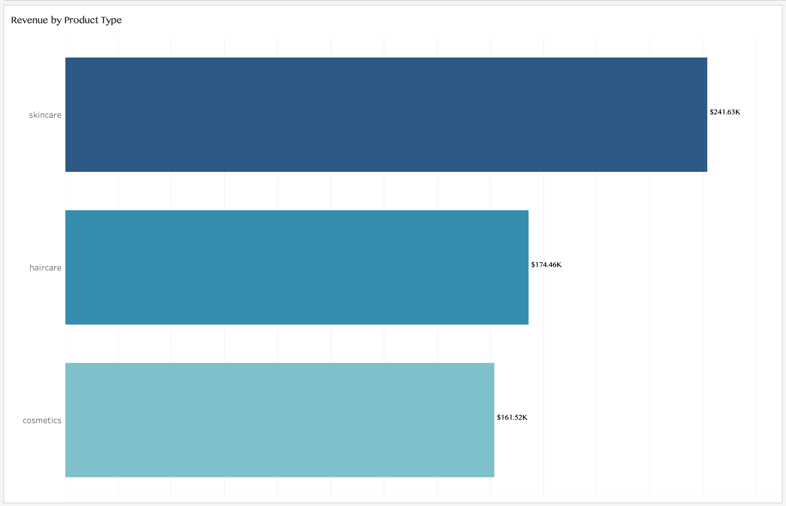
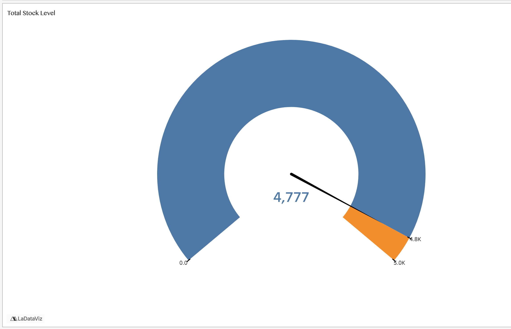
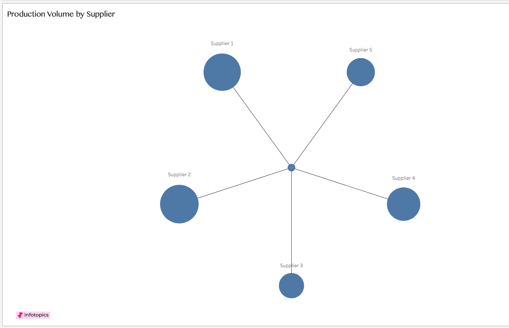
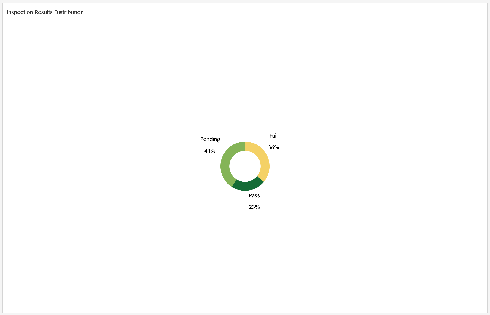
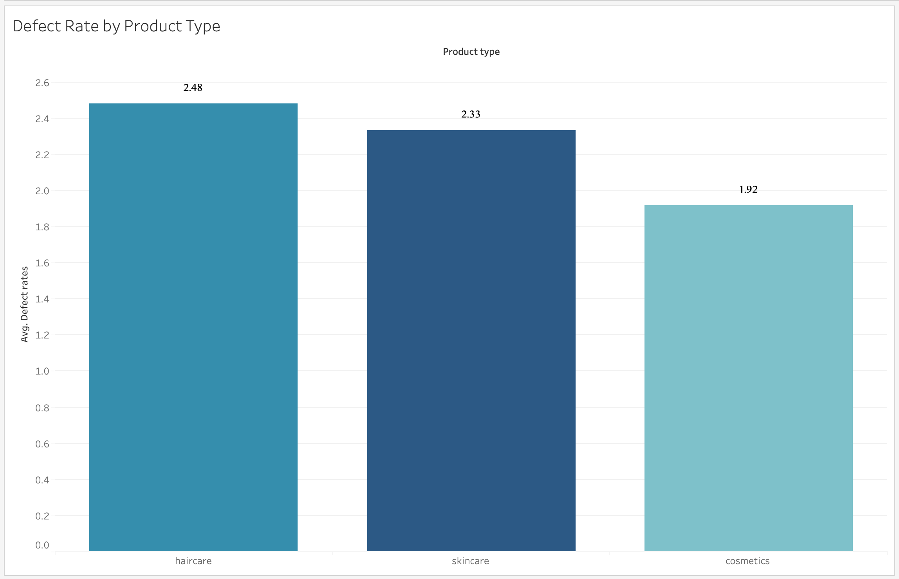
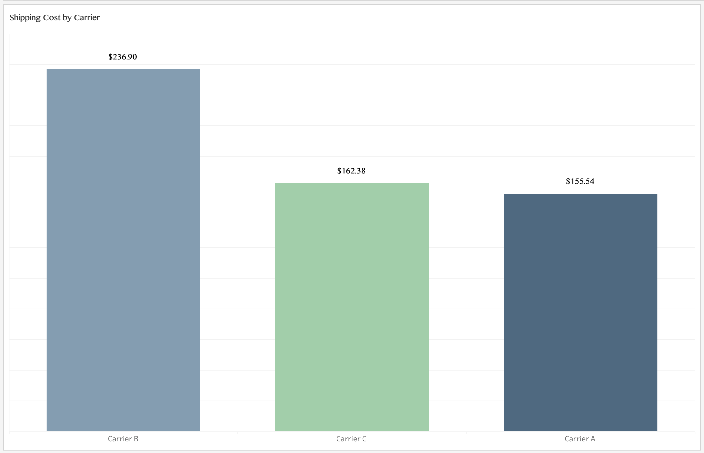
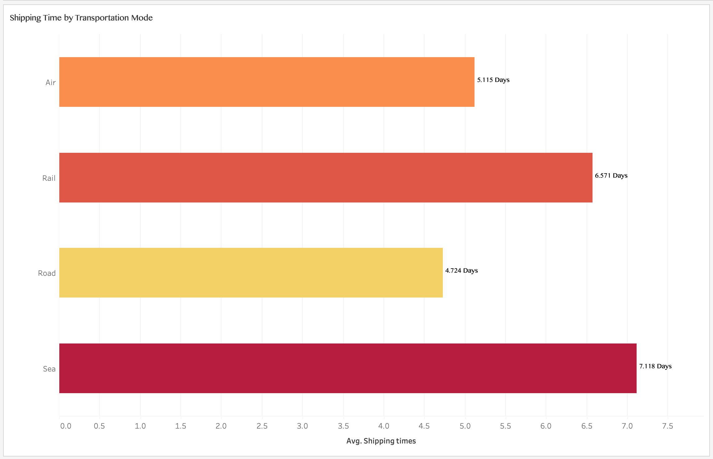

# 📦 Supply Chain & Production Analytics Dashboard

<p align="center">
  <strong>Turning Supply Chain Data into Actionable Business Insights</strong>
</p>

<p align="center">
  
  
  
</p>

---

## 📌 Project Overview

This project focuses on analyzing supply chain and production operations using **Tableau**.

The dashboard provides insights into revenue, inventory, manufacturing costs, supplier production, product quality, and shipping performance.

The objective is to transform raw data into meaningful visual insights that help identify operational trends, monitor business performance, and support data-driven decision-making.

## 🖥️ Dashboard Preview

<p align="center">
  
</p>

## 🎯 Key Performance Indicators (KPIs)

The dashboard highlights six important business metrics.

| KPI | Result |
|:---|---:|
| 💰 Total Revenue | **$577,604.82** |
| 📦 Total Products Sold | **46,099** |
| 🏭 Total Stock Levels | **4,777** |
| 📊 Total Availability | **4,840** |
| 🚚 Average Shipping Time | **5.75 Days** |
| 💵 Total Shipping Cost | **$554.81** |

## 📈 Dashboard Visualizations

### 1. Revenue by Product Type

Compares revenue generated across the three product categories.

| Product Type | Revenue |
|:---|---:|
| Skincare | $241.63K |
| Haircare | $174.46K |
| Cosmetics | $161.52K |

**Key Insight:** Skincare generates the highest revenue among the three product categories.



### 2. Manufacturing Costs by Product Type

Evaluates manufacturing expenses across product categories.

| Product Type | Manufacturing Cost |
|:---|---:|
| Skincare | $1,959.73 |
| Haircare | $1,647.57 |
| Cosmetics | $1,119.37 |

**Key Insight:** Skincare has the highest manufacturing cost, while cosmetics has the lowest.


### 3. Total Stock Level

A gauge visualization monitors current stock against a target of 5,000 units.

| Metric | Value |
|:---|---:|
| Current Stock | 4,777 |
| Target Stock | 5,000 |
| Remaining Capacity | 223 |
| Stock Utilization | 95.54% |

**Key Insight:** Current inventory is close to the defined stock target.



### 4. Production Volume by Supplier

Visualizes production volume across suppliers to compare their contributions.

**Key Insight:** Supplier 2 recorded the highest production volume at 14,105 units.



### 5. Inspection Results Distribution

Displays the percentage distribution of product inspection outcomes.

| Inspection Result | Percentage |
|:---|---:|
| 🟡 Pending | 41% |
| 🔴 Fail | 36% |
| 🟢 Pass | 23% |

**Key Insight:** Pending inspections represent the largest share, while 36% of inspection results are marked as failed.



### 6. Defect Rate by Product Type

Compares average defect rates across product categories.

| Product Type | Average Defect Rate |
|:---|---:|
| Haircare | 2.48 |
| Skincare | 2.33 |
| Cosmetics | 1.92 |

**Key Insight:** Haircare has the highest average defect rate, suggesting an area for closer quality monitoring.



### 7. Shipping Cost by Carrier

Compares shipping expenses across different carriers.

| Carrier | Shipping Cost |
|:---|---:|
| Carrier B | $236.90 |
| Carrier C | $162.38 |
| Carrier A | $155.54 |

**Key Insight:** Carrier B records the highest shipping cost among the three carriers.



### 8. Shipping Time by Transportation Mode

Analyzes average shipping duration across different transportation methods.

| Transportation Mode | Average Shipping Time |
|:---|---:|
| Sea | 7.118 Days |
| Rail | 6.571 Days |
| Air | 5.115 Days |
| Road | 4.724 Days |

**Key Insight:** Sea transportation has the longest average shipping time, while road transportation has the shortest.



---

## 💡 Key Business Insights

Based on the dashboard analysis:

- **Revenue:** Skincare is the leading product category by revenue.
- **Manufacturing:** Skincare records the highest manufacturing costs.
- **Inventory:** Current stock stands at 4,777 against a target of 5,000.
- **Supplier Performance:** Supplier 2 has the highest production volume.
- **Quality Control:** Haircare has the highest average defect rate.
- **Inspections:** A significant proportion of inspection results are pending or failed.
- **Shipping Costs:** Carrier B has the highest shipping cost.
- **Delivery Performance:** Road is the fastest transportation mode, while sea is the slowest.

## 🛠️ Tools & Technologies

| Tool | Purpose |
|:---|:---|
| Tableau Public | Data visualization and dashboard development |
| Microsoft Excel | Data inspection and preparation |
| Tableau Calculated Fields | Custom metrics and KPI calculations |
| Data Analysis | Exploring and interpreting business performance |

## 🎓 Skills Demonstrated

- Data exploration and analysis
- Data visualization
- KPI development
- Tableau calculated fields
- Interactive dashboard development
- Data interpretation
- Business insights and reporting
- Supply chain and production analysis

## 🏁 Conclusion

This project demonstrates how Tableau can transform supply chain data into actionable business insights.

By combining KPIs and multiple visualizations into one dashboard, it provides an overview of revenue, inventory, manufacturing, supplier production, product quality, and shipping performance.

The analysis highlights potential areas for improvement in quality monitoring, inventory management, manufacturing operations, and logistics.

---

## 📁 Repository Structure

```text
Supply-Chain-Analytics-Dashboard/
│
├── README.md
│
├── data/
│   └── supply_chain_data.csv
│
├── sql/
│   └── supply_chain.sql
│
├── dashboard/
│   └── supply_chain_dashboard.twbx
│
└── images/
    ├── supply-chain-dashboard.png
    ├── revenue-by-product-type.png
    ├── manufacturing-costs-by-product-type.png
    ├── total-stock-level-gauge.png
    ├── production-volume-by-supplier.png
    ├── inspection-results-distribution.png
    ├── defect-rate-by-product-type.png
    ├── shipping-cost-by-carrier.png
    └── shipping-time-by-transportation-mode.png
```

*Note: Replace example filenames with your actual uploaded files. Ensure all image paths match the filenames in your GitHub repository.*

---

## 👨‍💻 Author

**Vaibhav Borkar**

*Aspiring Data Analyst | Tableau | SQL | Excel | Data Visualization*

